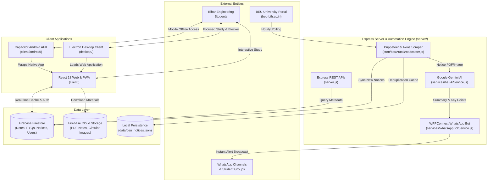

# Project Structure & Architecture Inventory
**Project**: Apna College Bihar (ACB)  
**Location**: `c:\Users\princ\OneDrive\Pictures\Desktop\my poject\Apna College Bihar`  
**Generated**: November 2026  

---

## 1. COMPREHENSIVE DIRECTORY TREE

```
Apna College Bihar/
├── .agent/
│   └── prd/
│       └── PRD.md                         # Autonomous product requirements & task lists
├── .agents/
│   ├── rules/                             # AI governance rules & design guidelines
│   └── skills/                            # Specialized toolkits (UI/UX, GEO, Debugging)
├── .github/                               # CI/CD workflows and automation actions
├── .gsd/
│   ├── PROJECT_CONTEXT.md                 # High-level architecture context
│   ├── ROADMAP.md                         # Project milestones and completion tracking
│   └── STATE.md                           # Active work state & blocker logs
├── acb mentorship/
│   ├── BEU_Mentorship_Contacts.vcf        # Exported VCF contacts for student batches
│   ├── create_contacts.py                 # Script to transform CSV registrations into VCF cards
│   ├── Free Mentorship for 1st Year...csv # Student registration database
│   ├── Google_Contacts_Import.csv         # Formatted CSV for Google Contacts bulk sync
│   ├── update_dashboard.py                # Dashboard updater for mentorship tracking
│   └── WhatsApp_Group_Helper.html         # Batch invitation helper UI
├── apk-src/                               # Native Android application resources & icons
├── client/                                # Main Web, PWA & Capacitor Application
│   ├── android/                           # Generated Capacitor Android native studio project
│   ├── public/                            # Static public assets, SEO files & SSG HTML
│   │   ├── blog/                          # 22 pre-rendered static blog HTML files
│   │   ├── college/                       # 38 pre-rendered engineering college HTML files
│   │   ├── grid.svg                       # Subtle background grid pattern
│   │   ├── llms.txt                       # LLM agent discovery & citation summary
│   │   ├── manifest.json                  # PWA web manifest
│   │   ├── robots.txt                     # Public search crawler directives
│   │   └── sitemap.xml                    # Canonical search engine sitemap (93 routes)
│   ├── src/
│   │   ├── components/                    # Reusable React UI widgets & modals
│   │   │   ├── video/
│   │   │   │   └── BEUNoticeReel.jsx      # Video reel generator for breaking notices
│   │   │   ├── AdminRoute.jsx             # Role-based route authorization guard
│   │   │   ├── ProtectedRoute.jsx         # Authentication route guard
│   │   │   ├── Footer.jsx                 # Universal semantic footer
│   │   │   ├── GlobalSearch.jsx           # Command palette search across all notes & tools
│   │   │   ├── MentorshipChat.jsx         # Real-time student-to-mentor messaging
│   │   │   ├── MobileBottomNav.jsx        # Fixed touch navigation for mobile viewports
│   │   │   └── WhatsAppPopup.jsx          # WhatsApp channel engagement modal
│   │   ├── context/
│   │   │   ├── AuthContext.jsx            # Firebase Auth provider with persistent local cache
│   │   │   └── StudyContext.jsx           # Focus timer, active session & task state
│   │   ├── data/
│   │   │   ├── blogPosts.js               # Academic articles, syllabus breakdowns & guides
│   │   │   ├── collegeData.js             # Detailed profiles for all 38 Bihar GECs
│   │   │   └── notesDefaultData.js        # Seed documents and semester syllabus structures
│   │   ├── layouts/
│   │   │   └── DashboardLayout.jsx        # Primary layout with responsive sidebar & navbar
│   │   ├── pages/                         # Route entry pages
│   │   │   ├── Home.jsx                   # Public marketing & study engine landing page
│   │   │   ├── AppHub.jsx                 # Mobile/Native portal hub
│   │   │   ├── Notes.jsx                  # Branch/Semester note repository
│   │   │   ├── PYQ.jsx                    # Previous Year Question paper library
│   │   │   ├── BeuSyllabus.jsx            # Official B.Tech curriculum navigator
│   │   │   ├── BeuCgpa.jsx                # Official university CGPA calculator
│   │   │   ├── UgeacPredictor.jsx         # BCECE JEE Main college & branch predictor
│   │   │   ├── FreeMentorship.jsx         # 1-on-1 senior guidance & booking platform
│   │   │   ├── HackathonHub.jsx           # Live student tech hackathons tracker
│   │   │   ├── Attendance.jsx             # 75% university attendance tracker
│   │   │   ├── Timetable.jsx              # Student class schedule manager
│   │   │   └── AdminPanel.jsx             # Administrative console for notes & notices
│   │   ├── services/                      # Client utility services (sync, chat, blocker)
│   │   ├── utils/                         # Helper functions (PDF generators, validation)
│   │   ├── App.jsx                        # Master routing, error boundaries & global modals
│   │   ├── firebase.js                    # Firebase App, Auth, Firestore & Storage initialization
│   │   ├── index.css                      # Global Tailwind directives & custom CSS variables
│   │   └── main.jsx                       # Application bootstrapping and root React DOM render
│   ├── build-sync.js                      # Multi-target build sync (Server public, Android, Root)
│   ├── generate-sitemap.js                # Programmatic sitemap generator
│   ├── generate-static-pages.js           # Static Site Generation (SSG) compiler
│   ├── package.json                       # Client dependencies & build scripts
│   ├── tailwind.config.js                 # Tailwind design tokens, fonts & animations
│   └── vite.config.js                     # Vite build configuration & Rollup chunking rules
├── counselling-system/                    # Standalone BCECE/UGEAC Data Analysis Workspace
│   ├── src/                               # Cutoff predictor UI components & datasets
│   ├── analyze_ranks_precise.py           # Statistical analysis of opening/closing ranks
│   ├── extract_excel_cutoffs.py           # Parser for official BCECEB allotment spreadsheets
│   ├── package.json                       # Standalone predictor configuration
│   └── vite.config.js                     # Independent predictor dev server
├── desktop/                               # Standalone Electron 33 Application
│   ├── assets/                            # Application icons (.ico, .png)
│   ├── build-app.js                       # Windows portable & NSIS installer packaging
│   ├── build-linux.js                     # Linux package generator (.tar.gz / AppImage)
│   ├── build-mac.py                       # macOS DMG / zip packaging script
│   ├── main.js                            # Electron main process with focus blocker daemon
│   ├── package.json                       # Desktop app build manifest
│   ├── preload.js                         # Electron IPC bridge
│   ├── offline.html                       # Resilient offline cached screen
│   └── splash.html                        # Native animated splash screen
├── dist-electron/                         # Built Windows executable artifacts
├── Java_PYQ_Folder/                       # Java OOP Exam Questions & Markdown guide
├── server/                                # Express Backend Daemon & Automation Engine
│   ├── cron/
│   │   ├── beuAutoBroadcaster.js          # BEU notice poll & automated broadcast coordinator
│   │   ├── beuNotificationFetcher.js      # Raw HTTP scraper for university portal
│   │   ├── dailyNotifier.js               # Scheduled morning study reminders
│   │   └── hackathonFetcher.js            # Automated crawler for collegiate hackathons
│   ├── middleware/
│   │   ├── authMiddleware.js              # JWT & Admin role verification
│   │   ├── errorHandler.js                # Centralized error handler & status mapper
│   │   ├── rateLimiter.js                 # Public & authenticated Express rate limiters
│   │   └── validate.js                    # Request schema validator
│   ├── models/                            # Mongoose database models (User, Note, Task, Document)
│   ├── public/                            # Static asset distribution & APK download store
│   │   ├── apna-college-bihar-v59.apk     # Direct Android APK distribution binary
│   │   ├── Apna-College-Bihar-Windows.zip # Desktop portable zip package
│   │   ├── ads.txt                        # Google AdSense crawler authorization
│   │   ├── robots.txt                     # Backend static robots.txt
│   │   └── sitemap.xml                    # Synced canonical sitemap
│   ├── routes/
│   │   ├── authRoutes.js                  # User registration, login, profile updates
│   │   ├── beuRoutes.js                   # Scraped notice queries & filter endpoints
│   │   ├── documentRoutes.js              # Study notes & PYQ API
│   │   ├── mentorshipRoutes.js            # Mentorship booking & application endpoints
│   │   └── taskRoutes.js                  # Student task checklist API
│   ├── schemas/                           # Zod validation schemas
│   ├── services/
│   │   ├── beuAiService.js                # Gemini multimodal PDF notice analysis & captioning
│   │   ├── beuScraper.js                  # Headless Puppeteer scraper for dynamic portals
│   │   └── whatsappBotService.js          # WPPConnect headless WhatsApp Web automation
│   ├── .env.example                       # Documented environment secrets template
│   ├── firebaseAdmin.js                   # Firebase Admin SDK initialization
│   ├── package.json                       # Server runtime dependencies
│   └── server.js                          # Express application entry, CORS, routes & downloads
├── AGENTS.md                              # Mandatory permanent AI agent rules & governance
├── AUDIT_REPORT.md                        # Master technical audit report
├── CHANGELOG.md                           # Chronological change log
├── PROJECT_DOCUMENTATION.md               # Architecture, API & system specifications
├── PROJECT_STATUS.md                     # System operational status & living health matrix
├── PROJECT_STRUCTURE.md                   # This document
├── robots.txt                             # Root search engine crawler rules
├── sitemap.xml                            # Root XML sitemap
└── vercel.json                            # Vercel deployment routes, headers & cleanUrls config
```

---

## 2. CROSS-MODULE DATA FLOW & RELATIONSHIPS



---

## 3. BUILD PIPELINE & ARTIFACT SYNCHRONIZATION

The production build pipeline is orchestrated by `client/package.json` (`npm run build`):
1. **Sitemap Generation (`generate-sitemap.js`)**: Queries blog posts, college slugs, and curated static routes to generate a clean 93-URL `sitemap.xml`.
2. **Vite Bundling (`vite build`)**: Compiles 2,026 modules into optimized ES2015 chunks with Rollup manual chunking.
3. **Static Site Generation (`generate-static-pages.js`)**: Injects static semantic HTML into 22 blog posts, 38 college profiles, and the root `index.html` for instant SEO rendering.
4. **Multi-Platform Asset Sync (`build-sync.js`)**:
   - Cleans old asset bundles and copies `client/dist/` into `server/public/`.
   - Cleans Android Capacitor assets and syncs optimized web assets into `client/android/app/src/main/assets/public/`.
   - Copies generated static HTML pages back into `client/public/` for Git and CDN tracking.
   - Synchronizes `sitemap.xml` and `robots.txt` directly to the project root.
